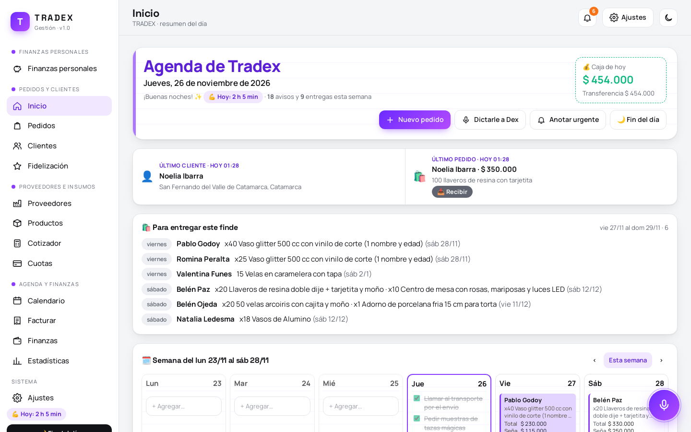
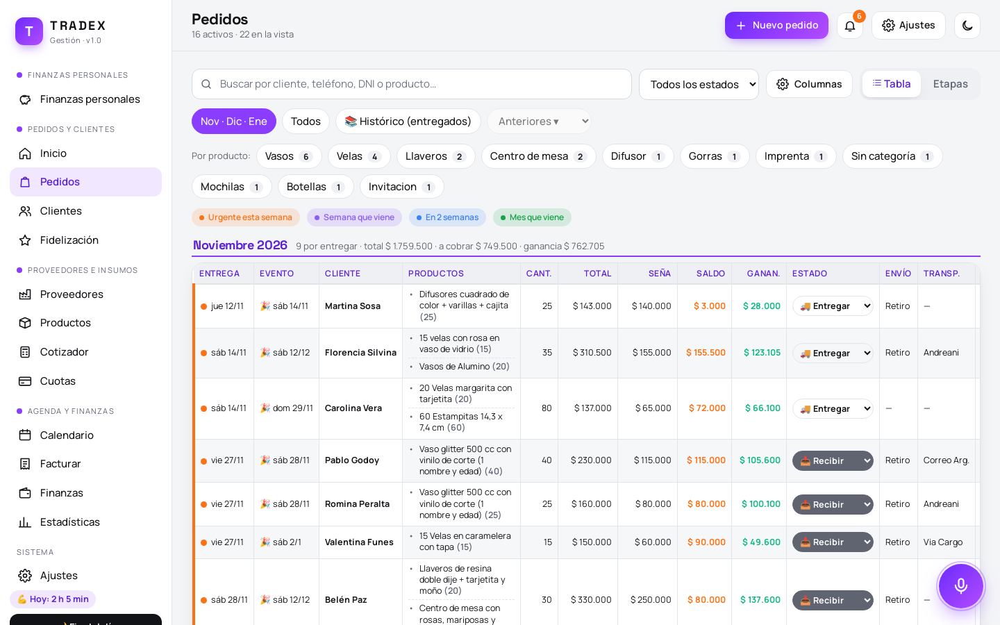
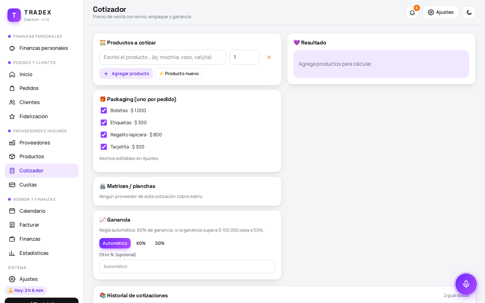
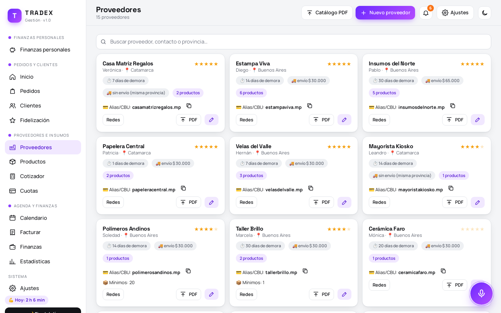
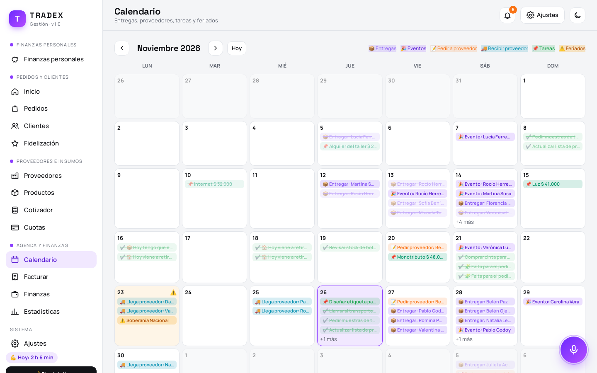
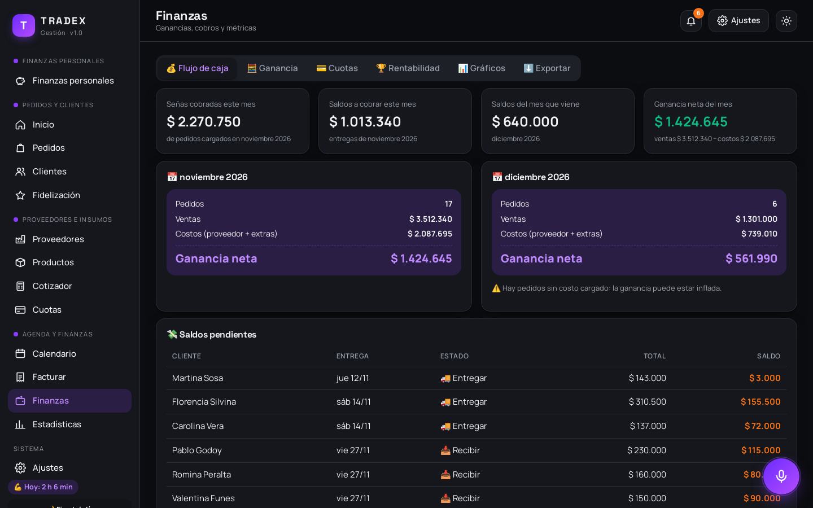
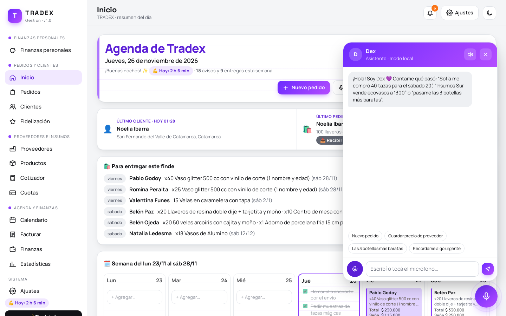
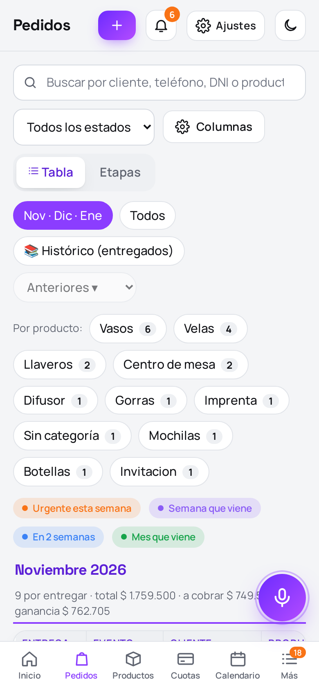

# TRADEX · Sistema de gestión con asistente por voz

Sistema de gestión para un emprendimiento de regalos personalizados y souvenirs: pedidos, clientes,
proveedores, productos, cotizador, agenda con avisos y finanzas, con **Dex**, una asistente por voz
que carga pedidos y precios a partir de frases dichas en voz alta.

Nació como la herramienta que uso todos los días en mi propio negocio. Esta es la versión pública:
**todos los datos son ficticios** (clientes, proveedores, pedidos y finanzas) y no tiene teléfonos, DNI
ni claves reales.



## Qué problema resuelve

Antes, los pedidos vivían en chats de WhatsApp, cuadernos y planillas sueltas. Se perdían fechas de
entrega, no se sabía cuánto dinero quedaba por cobrar y los precios de venta se calculaban a mano.
TRADEX junta todo en un solo lugar y **automatiza las tareas operativas que se repetían**:

| Proceso | Antes | Con TRADEX |
|---|---|---|
| Cargar un pedido | copiar del chat a una planilla | se dicta: «Lucía me compró 40 tazas a 6500 para el sábado 20» |
| Pedir al proveedor | de memoria | aviso automático según la fecha del evento y la demora del proveedor |
| Cotizar | calculadora y lista de precios en PDF | cotizador con envío, packaging y margen automáticos |
| Cobrar saldos | revisar chats | tablero de saldos pendientes y mensajes de WhatsApp prearmados |
| Saber si se gana dinero | a fin de mes, con suerte | ganancia neta por mes, por categoría y por canal |

## Flujo de un pedido

```
Señado ─► Pagado ─► Pedir al proveedor ─► Recibir del proveedor ─► Entregar / despachar ─► Entregado
            │               │                       │                        │
            │      aviso 3 y 2 semanas antes   seguimiento del envío     mensaje al cliente
            └── saldo pendiente en Finanzas
```

**Regla de avisos:** si el evento es un viernes o sábado, avisa 3 y 2 semanas antes para pedir al
proveedor; para otros días, según la demora del proveedor más 3 días de margen. Tiene en cuenta
los feriados nacionales y avisa los fines de semana largos.

## Capturas

| | |
|---|---|
|  **Pedidos** en tabla o tablero por etapas, con filtros y colores de urgencia. |  **Cotizador**: costo + envío + packaging + ganancia (60 %, o 50 % si supera $ 100.000). |
|  **Proveedores** con calificación, demora, envío y catálogo importable desde PDF. |  **Calendario** con entregas, pedidos al proveedor, tareas y feriados. |
|  **Finanzas** en modo oscuro: flujo de caja, saldos y ganancia neta. |  **Dex**, la asistente: entiende frases libres y pregunta lo que falta. |

<p align="center"></p>

## Funciones

- **Pedidos y clientes:** ficha de cliente, seña, saldo y pagos parciales, etapas, transporte y número
  de seguimiento, comprobante en PDF, duplicar pedido, fidelización de clientes frecuentes.
- **Proveedores y productos:** catálogo, mínimos, historial de precios, proveedor alternativo,
  costo de matriz, importación de listas de precios en PDF, combos.
- **Cotizador y cuotas:** precio sugerido con reglas editables y simulador de cuotas con recargo e IVA.
- **Agenda:** calendario, tareas, avisos en pantalla y del sistema, historial de avisos.
- **Finanzas:** flujo de caja, rentabilidad por categoría, gráficos por mes y canal, exportación a Excel,
  reporte PDF y finanzas personales separadas de las del negocio.
- **Asistente por voz (Dex):** con la API de Claude interpreta frases libres, busca datos de proveedores
  en internet y lee listas de precios. Sin clave funciona con un intérprete local.
- **PWA sin conexión:** cada dispositivo guarda todo en IndexedDB y sincroniza con la compu cada
  20 segundos; si dos editan lo mismo, gana la edición más reciente.
- **Copias de seguridad diarias** en el servidor (60 días + la primera de cada mes) y PIN opcional.

## Cómo probarla

```bash
npm install
npm start
```

Abrí **http://localhost:5190** (mejor en Chrome, que trae el dictado por voz). La primera vez el
servidor carga los datos ficticios de `demo/tradex-demo.json` en `data/tradex.json`. Para empezar
con la base vacía: `TRADEX_DEMO=0 npm start`.

**IA (opcional):** copiá `.env.example` como `.env` y completá `ANTHROPIC_API_KEY`.

## Stack

- **Backend:** Node.js con servidor HTTP propio, sin frameworks (`server.js`, `store.js`), base en un
  archivo JSON con revisiones para sincronizar.
- **Frontend:** HTML, CSS y JavaScript con módulos ES, sin frameworks ni build; IndexedDB y Service Worker.
- **IA:** SDK de Anthropic (`/api/assistant`, `/api/lookup`, `/api/catalog`) + Web Speech API.
- **Otros:** pdf.js para leer catálogos, notificaciones del sistema, systemd para el arranque automático.

```
server.js            servidor + endpoints de IA y sincronización
store.js             base central y copias de seguridad
demo/                datos ficticios de la demo
public/index.html    app (PWA)
public/js/db.js      base local (IndexedDB) y sincronización
public/js/alerts.js  motor de avisos y calendario
public/js/assistant.js  asistente por voz
public/js/views/     una vista por sección
```

## Marca

Grafito y gris frío con un **degradado violeta → morado** (`#6C2BFF` → `#B44CFF`); tipografías Space Grotesk y Manrope.
